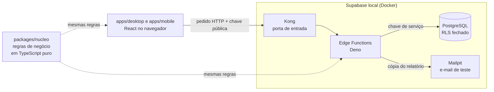

# 💼 Formulário Comercial — Visitas & Despesas (Desktop, Mobile PWA e Back-end)

<div align="center">

  [](https://github.com/sout-MMdev/formulario_comercial/actions/workflows/ci.yml)
  
  

  
  
  
  
  
  
  

  <br>

  <p align="center">
    <strong>Plataforma que substitui planilhas de Excel por dois apps (computador e celular) com cálculo financeiro automático, um núcleo de regras em TypeScript puro e um back-end com banco, funções e testes.</strong>
  </p>

  <p align="center">
    <a href="#desafio">O Desafio</a> •
    <a href="#guia">Guia para Avaliadores</a> •
    <a href="#arquitetura">Arquitetura</a> •
    <a href="#desktop-mobile">Desktop × Mobile</a> •
    <a href="#testes">Regras & Testes</a> •
    <a href="#como-executar">Como Executar</a> •
    <a href="#autor">Autor</a>
  </p>

</div>

---

<a name="desafio"></a>

## 🎯 O Desafio de Negócio: Do Excel ao App

Historicamente, as equipes comerciais externas e a gestão utilizavam **planilhas manuais de Excel** para registrar os atendimentos às agências parceiras, controlar os quilômetros rodados e prestar contas dos gastos de viagem (combustível, refeições e hospedagens).

### Os Problemas da Operação Manual:
* ❌ **Fórmulas Quebradas & Erros de Cálculo:** A tarifa por quilômetro rodado variava conforme o executivo, gerando frequentes divergências manuais nos fechamentos de reembolso.
* ❌ **Comprovantes Perdidos:** Recibos fiscais se perdiam no trânsito antes de chegar ao departamento financeiro.
* ❌ **Falta de Dados Estruturados:** A gestão não conseguia monitorar em tempo real o nível de estresse ou insatisfação das agências visitadas.
* ❌ **Processo Lento e Descentralizado:** Preenchimentos demorados no fim do expediente geravam atrasos no pagamento de reembolsos.

### A Solução Implementada:
Desenvolvi **dois aplicativos** (Desktop e Mobile PWA) que compartilham um **núcleo de regras em TypeScript puro**, e um **back-end em Supabase** que recebe os relatórios. O sistema calcula na hora os valores a reembolsar, exige comprovante só para compras no cartão pessoal, salva o histórico no dispositivo e grava cada dia no banco de forma segura: o servidor **refaz as contas com a tarifa do banco**, grava tudo numa transação só e manda uma cópia por e-mail ao executivo.

---

<a name="guia"></a>

## 🚀 Guia Rápido para Avaliadores & Recrutadores

### 1. Ver funcionando em 2 comandos (sem Docker)

O **modo demonstração** usa dados fictícios e simula o envio — nada de banco ou chaves:

```bash
npm install
npm run dev:desktop   # http://localhost:5501
```

### 2. Ver o back-end de verdade (com Docker)

Com o Docker Desktop aberto, o Supabase sobe **na sua máquina**, sem conta:

```bash
npm run backend:iniciar        # banco PostgreSQL + Edge Functions + caixa de e-mail
npm run backend:conectar-apps  # liga os apps ao back-end local
npm run dev:desktop
```

Preencha um relatório, clique em **Salvar o dia** e confira:
* as linhas gravadas no **Supabase Studio**: http://127.0.0.1:54323 (tabela `relatorios`);
* a cópia por e-mail no **Mailpit**: http://127.0.0.1:54324.

### 3. Rodar os testes

```bash
npm test                  # núcleo + back-end (sem Docker)
npm run backend:testar    # banco (pgTAP) + Edge Functions pela rede (com Docker)
```

### Cenários prontos para testar
* **Tarifas Dinâmicas de KM:** *Diego Martins* tem tarifa de R$ 1,43/km e *Paulo Souza* R$ 1,30/km. Veja o reembolso atualizar no resumo ao vivo.
* **Classificação de Despesas:** gasto no **Cartão Pessoal** exige comprovante e soma no reembolso; **abastecimento no Cartão Clara** é descontado.
* **Termômetro de Relacionamento:** estresse *Médio*, *Alto* ou *Crítico* exige descrição e setores.
* **Histórico Local:** depois de salvar, o dia aparece em "Dias salvos", mesmo fechando o navegador (`localStorage`).
* **Mobile PWA:** `npm run dev:mobile` (porta 5502), interface com alvos de toque de 56px; protótipo de login em `http://localhost:5502/?login`.

---

<a name="arquitetura"></a>

## 🏛️ Arquitetura em 1 minuto



* **O mesmo código de regras roda nos dois apps e no servidor.** Mudou uma regra no núcleo, os três acompanham.
* **O servidor não confia no navegador:** valida tudo de novo e recalcula o dinheiro com a tarifa do banco.
* **O banco é fechado:** RLS em todas as tabelas; o navegador não lê nem grava nada direto, só pelas três Edge Functions.
* **Gravação atômica e idempotente:** o dia inteiro entra numa transação; enviar duas vezes não duplica.

📖 Detalhes, diagramas, decisões e limitações: **[docs/ARQUITETURA.md](docs/ARQUITETURA.md)**.

### Mapa do repositório

```
formulario_comercial/
├── apps/                 FRONT-END
│   ├── desktop/          App para computador (abas + resumo ao vivo)
│   └── mobile/           App para celular (PWA, um passo por tela)
├── packages/             COMPARTILHADO
│   ├── nucleo/           Regras de negócio, estado e tipos (TypeScript puro)
│   └── tema/             Cores, tipografia e efeitos (tokens CSS)
├── backend/              BACK-END
│   ├── supabase/         migrations, seed, testes pgTAP e Edge Functions
│   ├── testes/           testes de unidade e de integração das funções
│   └── scripts/          liga os apps ao back-end local
├── docs/                 arquitetura, apps e planejamento
└── .github/workflows/    CI: testes a cada push
```

Cada pasta principal tem um `README.md` dizendo o que tem ali e onde mexer.

### O que é compartilhado vs. específico:

| Recurso / Camada | Compartilhado? | Implementação |
| :--- | :---: | :--- |
| **Regras de Negócio e Cálculos Financeiros** | ✅ **Sim** (apps e servidor) | `@cativa/nucleo` (sem React) |
| **Gerenciamento de Estado do Formulário** | ✅ **Sim** | `@cativa/nucleo/estado` (formularioReducer) |
| **Design Tokens & Variáveis Visuais** | ✅ **Sim** | `@cativa/tema` (CSS) |
| **Envio, Histórico Local e APIs (IBGE, ViaCEP)** | ✅ **Sim** | `@cativa/nucleo/servicos` |
| **Layout e Navegação** | ❌ **Específico** | Desktop (Abas) × Mobile (Passos) |
| **Banco, Chave de Serviço e E-mail** | 🔒 **Só no servidor** | `backend/` (Edge Functions + PostgreSQL) |

---

<a name="desktop-mobile"></a>

## 📱 Desktop × Mobile PWA

A versão mobile não é apenas o desktop reduzido; ela foi construída seguindo diretrizes de ergonomia móvel:

```
Fluxo Mobile:
1. Quem está preenchendo? ➔ 2. O que vai registrar?
                                  ├── Visita:   3. Data ➔ 4. Agências ➔ 5. Análise de Relacionamento
                                  └── Despesas: 3. Trajetos ➔ 4. Gastos
                                                                 ↓
                                                             Resumo Final
```

| Aspecto | Versão Desktop | Versão Mobile (PWA) |
| :--- | :--- | :--- |
| **Navegação** | Abas horizontais com trilha lateral | Passo a passo com barra de progresso |
| **Densidade** | 2 a 3 campos por linha | Um assunto por tela |
| **Altura dos Campos** | 46px | **56px** (área de toque ideal no polegar) |
| **Tamanho da Fonte** | 15px | **16px** (evita zoom indesejado no iOS Safari) |
| **Botões de Ação** | Rodapé do painel | **Barra fixa inferior** na zona de conforto |
| **Comprovantes** | Upload de arquivo | **Câmera direta** ou galeria de fotos |
| **Área Visível** | `100vh` | `100dvh` + suporte a *safe areas* do iPhone |

---

<a name="testes"></a>

## 🧪 Regras de Negócio & Testes

| Camada | Testes | O que cobre |
| :--- | :---: | :--- |
| **Núcleo** (`packages/nucleo`) | 72 | Reembolso, validações, fluxo das etapas, envio e formatadores |
| **Unidade do back-end** (`backend/testes/unidade`) | 61 | Validação do corpo, recálculo no servidor, processamento, HTTP, e-mail |
| **Banco** (pgTAP, `backend/supabase/tests`) | 92 | Tabelas, RLS, privilégios, regras, gravação atômica, views |
| **Integração** (`backend/testes/integracao`) | 11 | As Edge Functions chamadas pela rede, com banco e e-mail |
| **Total** | **236** | O **CI** roda todos a cada push |

### Regras Principais Validadas nos Testes:
* **Fórmula de Fechamento do Dia:**
  $$\text{Total a Reembolsar} = \text{Reembolso KM} + \text{Cartão Pessoal} - \text{Abastecimento Cartão Clara}$$
* **Obrigatoriedade de Comprovantes:** nota fiscal exigida para despesas no cartão pessoal; dispensada no cartão corporativo.
* **Gatilho de Ocorrência:** descrição obrigatória para estresse Médio, Alto e Crítico.
* **Dinheiro recalculado no servidor:** um reembolso alterado no navegador é ignorado; vale km × tarifa do banco.
* **Envio honesto:** a tela só diz "Relatório enviado" quando o servidor aceitou; na falha, mostra o motivo e mantém os dados.

---

<a name="como-executar"></a>

## ⚙️ Como Executar

### Pré-requisitos
* [Node.js](https://nodejs.org/) **22.18 ou mais novo** (os testes rodam TypeScript direto no Node).
* `npm`.
* Para o back-end: [Docker Desktop](https://www.docker.com/products/docker-desktop/) aberto.

### 1. Clonar e Instalar
```bash
git clone https://github.com/sout-MMdev/formulario_comercial.git
cd formulario_comercial
npm install
```

### 2. Modo demonstração (sem Docker)
```bash
npm run dev:desktop   # http://localhost:5501
npm run dev:mobile    # http://localhost:5502
```

### 3. Modo completo (com Docker)
```bash
npm run backend:iniciar         # Supabase local: banco, funções e e-mail
npm run backend:conectar-apps   # apps passam a usar o back-end local
npm run dev:desktop
# ...
npm run backend:desconectar-apps   # volta ao modo demonstração
npm run backend:parar
```

Comandos, endereços e "onde mexer para…": **[backend/README.md](backend/README.md)**.

### 4. Verificação
```bash
npm run typecheck         # tipos de todos os pacotes
npm test                  # núcleo + unidade do back-end
npm run backend:testar    # banco + Edge Functions (Docker)
npm run backend:checar-funcoes   # tipos do código Deno das funções
```

---

<a name="autor"></a>

## 👨‍💻 Autor

Desenvolvido por **Maxuel Monteiro (sout-MMdev)**.

[](https://github.com/sout-MMdev)
[](https://www.linkedin.com/in/maxuel-monteiro/)
