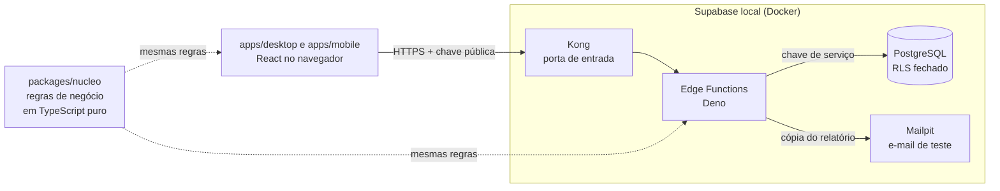
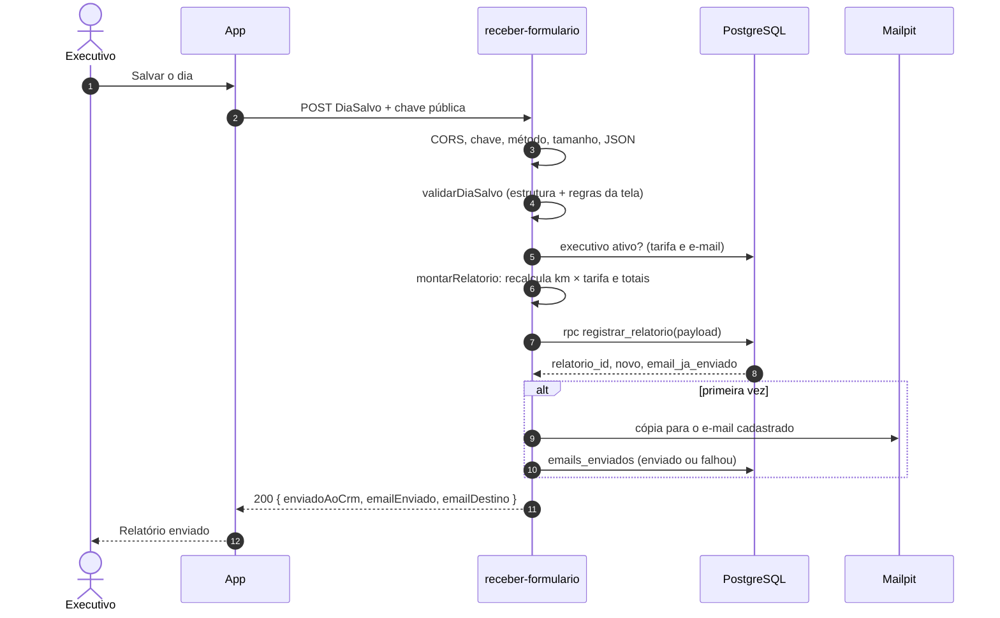
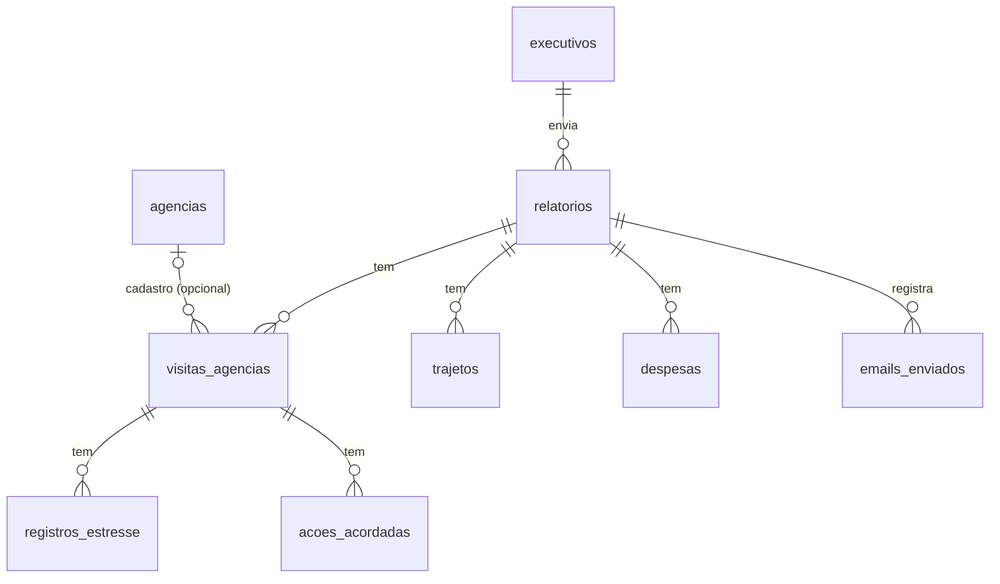

# Arquitetura

Como o Formulário Comercial funciona por dentro: as camadas, o caminho de um
relatório do clique até o banco, as pastas e as decisões tomadas, com o porquê
e o custo de cada uma.

> Ordem sugerida de leitura: **1 → 3 → 6**. As outras seções são consulta.

---

## 1. Visão geral

Dois apps de front-end (computador e celular) usam o mesmo **núcleo de regras**
em TypeScript puro. Quando há back-end configurado, eles falam com três
**Edge Functions** do Supabase, que validam, recalculam e gravam no
**PostgreSQL**, e mandam uma cópia por e-mail.



O mesmo código de regras roda em três lugares: no app do computador, no app do
celular e no servidor. Se uma regra muda no núcleo, os três acompanham.

---

## 2. As três camadas

| Camada | Pasta | O que faz | Tecnologia |
|---|---|---|---|
| **Front-end** | `apps/desktop`, `apps/mobile` | Telas, navegação, rascunho local | React, Vite, PWA |
| **Compartilhado** | `packages/nucleo`, `packages/tema` | Regras de negócio, estado, tipos; tokens visuais | TypeScript puro, CSS |
| **Back-end** | `backend/` | Funções HTTP, banco, testes do servidor | Supabase, Deno, PostgreSQL |

**Sem back-end configurado** (o site publicado), os apps entram no **modo
demonstração**: listas fictícias e envio simulado. Com back-end (variáveis
`VITE_SUPABASE_*`), as mesmas telas usam as funções de verdade. A troca
acontece em um lugar só: `packages/nucleo/src/servicos/envio/index.ts`.

---

## 3. O caminho de um relatório

O que acontece quando o executivo clica em **"Salvar o dia"**, em ordem, com o
arquivo responsável por cada passo:

| # | Passo | Onde está |
|---|---|---|
| 1 | O app monta o dia (`DiaSalvo`) e chama `finalizarDia` | `apps/*/src/contexto/FormularioContexto.tsx` |
| 2 | `envioApi` faz `POST /functions/v1/receber-formulario` com a chave pública | `packages/nucleo/src/servicos/envio/envioApi.ts` |
| 3 | A função confere CORS, chave pública (401) e método (405) | `backend/supabase/functions/_compartilhado/http.ts` (`criarTratador`) |
| 4 | Lê o corpo: até 256 KB (413) e JSON válido (400) | `http.ts` (`lerCorpoJson`) |
| 5 | Valida a estrutura e aplica **as mesmas regras da tela** (400) | `_compartilhado/validacao.ts` |
| 6 | Busca o executivo ativo no banco: tarifa e e-mail (422 se não existir) | `_compartilhado/servidor.ts` |
| 7 | **Recalcula o dinheiro**: km × tarifa do banco e os totais do dia | `_compartilhado/montagem.ts` |
| 8 | Grava tudo numa transação só (`registrar_relatorio`) | `backend/supabase/migrations/…_registrar_relatorio.sql` |
| 9 | Se é a primeira vez, manda a cópia para o e-mail **cadastrado** e registra a tentativa | `_compartilhado/email.ts`, `processar.ts` |
| 10 | Responde `200 { enviadoAoCrm, emailEnviado, emailDestino }` | `_compartilhado/processar.ts` |
| 11 | A tela mostra "Relatório enviado" **só se o CRM aceitou**; na falha, mostra o motivo e mantém os dados | `packages/nucleo/src/servicos/envio/situacaoEnvio.ts` |



As duas funções de leitura são mais simples: `listar-executivos` devolve
`[{ nome, email }]` dos ativos e `listar-agencias` devolve os nomes, ambas em
ordem alfabética.

---

## 4. O banco de dados



- **Um relatório = um dia** de um executivo. Os filhos (visitas, trajetos,
  despesas…) são apagados junto com ele (`on delete cascade`).
- **Regras também no banco**, como última barreira: estresse a partir de
  "Médio" exige descrição, agência não se repete (sem diferenciar maiúsculas e
  espaços), valores não negativos, fluxos válidos.
- **Segurança:** RLS ligado em todas as tabelas, uma política explícita
  "sem acesso pelo navegador" e os privilégios de `anon`/`authenticated`
  revogados. O navegador não lê nem grava nenhuma tabela; só as funções, com a
  chave de serviço.
- **Views de gestão:** `v_reembolso_mensal` (quanto cada executivo recebe por
  mês) e `v_agencias_em_alerta` (agências cujo estresse mais recente é Alto ou
  Crítico).
- **Migrations** em `backend/supabase/migrations/`, aplicadas em ordem;
  **seed** fictício em `backend/supabase/seed.sql`.

---

## 5. Pastas

```
formulario_comercial/
├── apps/                        FRONT-END
│   ├── desktop/                 App para computador (abas + resumo ao vivo)
│   │   └── src/
│   │       ├── abas/            uma pasta por etapa: Identificacao, Visita, Agencias, Despesas, Resumo
│   │       ├── componentes/     ui/ (botões, campos, modal), layout/ (cabeçalho, trilha), campos/
│   │       ├── contexto/        liga o estado do núcleo às telas
│   │       ├── hooks/           useDiasSalvos, useDebounce…
│   │       └── estilos/         CSS em camadas (@layer)
│   └── mobile/                  App para celular (PWA, um passo por tela)
│       └── src/
│           ├── passos/          um arquivo por passo do fluxo
│           ├── navegacao/       ordem dos passos
│           ├── login/           tela de login (protótipo, ver docs/planejamento)
│           ├── componentes/ · contexto/ · hooks/ · estilos/
│
├── packages/                    COMPARTILHADO
│   ├── nucleo/                  Regras de negócio em TypeScript puro (sem React)
│   │   └── src/
│   │       ├── regras/          reembolso, validação, fluxo, estresse (+ testes)
│   │       ├── servicos/        envio (real e simulado), armazenamento local, IBGE, ViaCEP
│   │       ├── estado/          reducer do formulário (usado pelos dois apps)
│   │       ├── config/          tarifas, executivos e agências fictícios, URLs
│   │       └── tipos/ · utils/
│   └── tema/                    Tokens visuais (cores, tipografia, efeitos)
│
├── backend/                     BACK-END
│   ├── supabase/
│   │   ├── config.toml          configuração do Supabase local
│   │   ├── migrations/          schema, função registrar_relatorio, views
│   │   ├── seed.sql             dados fictícios
│   │   ├── tests/               testes do banco (pgTAP)
│   │   └── functions/
│   │       ├── _compartilhado/  código comum das funções (validar, montar, processar, HTTP, e-mail)
│   │       ├── listar-executivos/
│   │       ├── listar-agencias/
│   │       └── receber-formulario/
│   ├── testes/
│   │   ├── unidade/             testes do código das funções (Node, sem Docker)
│   │   └── integracao/          chamam as funções pela rede (Supabase local)
│   └── scripts/                 conectar os apps ao back-end local
│
├── docs/                        esta documentação
└── .github/workflows/ci.yml     testes automáticos a cada push
```

**Regra de ouro das pastas:** regra de negócio mora em `packages/nucleo`;
tela mora em `apps/`; o que só o servidor pode fazer (banco, chave de serviço,
e-mail) mora em `backend/`.

---

## 6. Decisões e trade-offs

### 6.1 O servidor recalcula o dinheiro
- **Decisão:** o reembolso enviado pelo navegador é ignorado; o servidor refaz
  km × tarifa (do banco) e os totais com `calcularTotaisDia()` do núcleo.
- **Por quê:** o navegador pode ser alterado por quem quiser; dinheiro não pode
  depender dele.
- **Custo:** a tarifa precisa estar certa no banco; se a tela mostrar uma tarifa
  diferente, vale a do banco.

### 6.2 Banco fechado; só as funções acessam
- **Decisão:** RLS em todas as tabelas, sem nenhuma permissão para o navegador;
  as funções usam a chave de serviço.
- **Por quê:** o app não tem login. Abrir tabelas para a chave pública deixaria
  qualquer pessoa ler ou gravar dados.
- **Custo:** toda leitura nova precisa de uma função (ou de login, no futuro).

### 6.3 Gravação numa função SQL transacional
- **Decisão:** `registrar_relatorio(payload)` grava o relatório e todos os
  itens numa transação.
- **Por quê:** ou entra tudo, ou nada. Sem relatório "pela metade" se um item
  for inválido.
- **Custo:** parte da lógica fica em PL/pgSQL, coberta por testes pgTAP.

### 6.4 Idempotência por (executivo, id do dia)
- **Decisão:** o app gera um id por dia; `unique (executivo_id, id_cliente)` +
  `on conflict do nothing`.
- **Por quê:** clique duplo ou internet que cai e volta não duplicam relatório
  nem e-mail.
- **Custo:** se a primeira tentativa gravou mas o e-mail falhou, o reenvio não
  tenta o e-mail de novo (fica registrado como "falhou" em `emails_enviados`).

### 6.5 Servidor tão rígido quanto a tela, nem mais nem menos
- **Decisão:** o servidor aplica as mesmas funções de validação da tela, mais
  limites de estrutura (tamanhos, quantidades, datas reais).
- **Por quê:** um relatório aceito pela tela nunca é recusado pelo servidor, e o
  que a tela recusa o servidor também recusa, com a mesma mensagem.
- **Custo:** regras que a tela não cobra o servidor também não cobra (ver
  limitações).

### 6.6 Cópia para o e-mail cadastrado
- **Decisão:** a cópia vai para o e-mail do executivo no banco, não para o
  digitado no formulário.
- **Por quê:** evita que o sistema vire um disparador de e-mails para
  qualquer endereço.
- **Custo:** se o executivo quiser receber em outro e-mail, o cadastro precisa
  mudar.

### 6.7 E-mail exposto em `listar-executivos`
- **Decisão:** a função devolve nome e e-mail, como o app já esperava.
- **Por quê:** manter o contrato do front sem mudanças; os dados são fictícios.
- **Custo:** com dados reais, o e-mail deveria ser resolvido só no servidor (o
  app mandaria só o nome).

### 6.8 Regras do núcleo usadas direto nas funções
- **Decisão:** `_compartilhado/nucleo.ts` importa `packages/nucleo` por caminho
  relativo; o Supabase CLI empacota junto.
- **Por quê:** uma regra, um lugar. Sem cópia que fica desatualizada.
- **Custo:** o núcleo precisa continuar sem dependências de navegador (já é
  uma regra do projeto).

### 6.9 Classificação de despesa espelhada na view SQL
- **Decisão:** `v_reembolso_mensal` repete em SQL a regra de
  `classificarDespesa()`, com comentário apontando para o original.
- **Por quê:** relatórios de gestão rodam no banco, sem passar pelo TypeScript.
- **Custo:** a regra existe em dois lugares; o teste `03_views` confere que a
  view soma o mesmo que os relatórios.

### 6.10 Site publicado em modo demonstração
- **Decisão:** o site na Vercel roda sem back-end (listas fictícias e envio
  simulado).
- **Por quê:** qualquer pessoa testa sem conta, e nenhum dado real fica
  exposto. O back-end completo roda localmente com Docker.
- **Custo:** quem quiser ver banco e e-mail precisa rodar localmente.

### 6.11 Mailpit no lugar de um provedor de e-mail
- **Decisão:** o e-mail vai para o Mailpit (caixa de teste do Supabase local),
  atrás da interface `EnviadorEmail`.
- **Por quê:** testável sem conta nem custo; trocar por Resend/SES é escrever
  outro adaptador com o mesmo método `enviar()`.
- **Custo:** nenhum e-mail sai de verdade no ambiente local.

---

## 7. Testes

| Camada | O que cobre | Onde | Comando |
|---|---|---|---|
| Núcleo (67) | Reembolso, validação, fluxo, envio, formatadores | `packages/nucleo/src/**/*.teste.ts` | `npm test` |
| Unidade do back-end (53) | Validação, montagem, processamento, HTTP, e-mail, scripts | `backend/testes/unidade/` | `npm test` |
| Banco — pgTAP (90) | Tabelas, RLS, privilégios, constraints, função, views | `backend/supabase/tests/` | `npm run backend:testar-banco` |
| Integração (11) | As funções chamadas pela rede, com banco e Mailpit | `backend/testes/integracao/` | `npm run backend:testar-funcoes` |

O **CI** (`.github/workflows/ci.yml`) roda tudo a cada push: um job para o
front (tipos, testes, build) e outro que sobe um Supabase temporário no GitHub
e roda os testes do banco e das funções.

---

## 8. Limitações conhecidas

- **Datas opcionais:** a tela marca a data de trajetos e despesas com `*`, mas a
  validação do núcleo não a exige; o servidor segue o núcleo (decisão 6.5).
  Item sem data conta no mês em que o relatório chegou.
- **Sem login:** quem tem a chave pública pode enviar um relatório em nome de
  um executivo ativo. Em produção, o caminho é o login com Supabase Auth
  (planejado em `docs/planejamento/login-mobile.md`).
- **Comprovantes:** só o nome do arquivo é guardado; não há upload.
- **Histórico local:** "Dias salvos" mostra os dias enviados neste navegador,
  sem botão de reenviar.
- **Lista de executivos:** aparece primeiro com os dados de demonstração e é
  trocada pela do servidor assim que ele responde.
